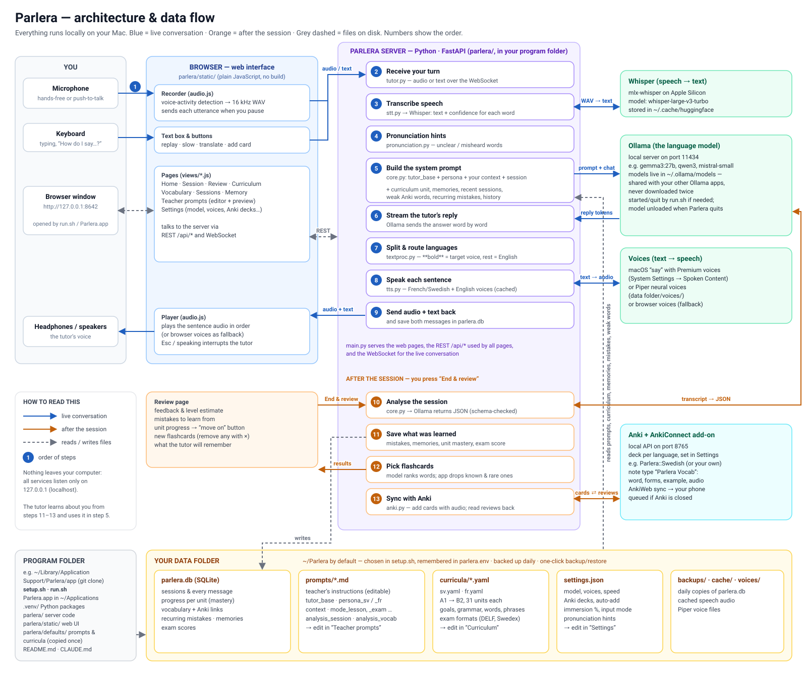

# Parlera — your private, local language tutor 🇸🇪 🇫🇷 🇬🇧

Parlera is a speaking-first language tutor that runs **entirely on your Mac**. You talk to a
teacher, who answers with a real voice, follows a curriculum, remembers you between sessions, and
turns each session's most useful vocabulary into **Anki flashcards** automatically.

| Course | Teacher | Levels | Aimed at |
|---|---|---|---|
| 🇸🇪 Swedish | Astrid | A1 → B2 (from zero) | Swedex, later TISUS |
| 🇫🇷 French | Élodie | A1 → B2 (refresh school French) | DELF |
| 🇬🇧 English | Oliver (former IELTS examiner) | B2 → C2, starts at C1 | IELTS Academic, TOEFL iBT, Duolingo English Test |

*"Parlera" means "will speak" in French and "to chat" in Swedish.*

Nothing leaves your computer: the language model runs in [Ollama](https://ollama.com), speech
recognition with Whisper, voices with macOS or Piper, and all your data lives in `~/Parlera`.



*How it fits together: what you say goes through Whisper and Ollama and comes back as speech.
After each session, the analysis feeds your progress, mistakes, memories and Anki cards back into
the next session. All prompts, curricula and your data live in plain files you can edit.*

---

## Features

**Conversation**
- Situation presets in every session: *Talk & listen*, *Can't speak* (you type, the tutor talks), *Can't listen* (you talk, the tutor writes) and *Silent*.
- **Chat break**: *Fika* (Swedish), *Pause café* (French) or *Tea time* (English) in the sidebar. A relaxed chat outside the curriculum, with light corrections and no review needed.
- **Message your teacher** (sidebar): write a note any time, e.g. "job interview on Friday, practise for it" or "please speak slower". It's turned into instructions you confirm, for 7 days, 30 days or permanently. Manage them under *Memory → Teacher instructions*.
- Voice conversations: *hands-free* (just talk; it answers when you pause), *push-to-talk* (hold the button or the space bar), or *text*.
- A real voice, with the target language and English each spoken by the right voice in the same sentence.
- Tells you which language you're speaking (Swedish/French, English or auto) for accurate transcripts.
- Streaming replies: the tutor starts speaking after its first sentence.
- Mostly in the target language: when you answer in English, it shows you how to say it and asks you to try. **It also corrects your English.**
- Gentle ✏️ corrections, replay and slow replay, translate any message, "How do I say…?" helper.
- Listening mode: hide the text, then reveal it message by message.
- Click any **blue word** to hear it or turn it into a flashcard.

**Pronunciation feedback.** Whisper's per-word confidence, plus a comparison when you repeat a modelled phrase, flags words that didn't sound right. They're underlined in your message and the tutor gives you a targeted tip. There's a dedicated *Pronunciation* session type too. See [How pronunciation feedback works](#how-pronunciation-feedback-works).

**Mistake workshop**
- Every mistake from your session reviews is stored with its real examples.
- Once a week (adjustable), the dashboard offers a workshop. The model can *think* while it groups your recent mistakes by underlying principle and works out why you make them, explaining each rule with your own examples.
- The session then trains each group: the principle, correcting your own sentences, drills of increasing difficulty, and a mixed review. Patterns you master are marked as resolved.
- You can also start a workshop any time from *Focus areas* or *Memory → Recurring mistakes*.

**Curriculum and progress**
- Swedish and French: 31 units each, A1 to B2. English: 19 units, B2 to C2. Every unit has can-do goals, grammar, vocabulary, phrases, pronunciation and culture notes. Aimed at **DELF** (French), **Swedex / TISUS** (Swedish) and **IELTS / TOEFL / Duolingo English Test** (English).
- Session types: guided lesson, conversation, role-play, review, pronunciation, exam simulation (scored), writing practice, placement check and free talk.
- After each session: feedback, a list of your mistakes, unit mastery, level estimate, exam score, and a suggestion to move on when you're ready.
- Recurring mistakes and weak Anki cards flow into later sessions automatically.

**Memory**
- Every session is saved and can be **resumed later**; the tutor remembers the whole conversation.
- The tutor builds up long-term memories about you (job, plans, preferences), and you can edit, pin or switch off each one.
- You can add personal notes that the tutor should always keep in mind.

**Anki**
- **Recently learned words come back in conversation.** Each session, the tutor gets a few words you added in the last weeks and weaves two or three of them in naturally, without quizzing you. Young cards (added 1–21 days ago, short Anki interval) come up most often; mature cards (interval of 21 days or more) rarely; words older than 90 days not at all. Words you keep failing are practised more directly instead. Review data is synced from Anki when a session starts.
- **Import existing decks.** *Vocabulary → Import from Anki* links cards you made elsewhere (e.g. your English deck), keeping their real creation dates and review history. Nothing in Anki is changed.
- New words are added to your **chosen deck** automatically after each session, with audio, an example sentence from your conversation, en/ett or le/la colour coding, and reverse cards.
- If Anki is closed, words are queued and sent the next time it's open. You can remove single cards on the review page.
- Review data (intervals, lapses) is synced back so the tutor practises the words you keep forgetting.
- If you don't want to use AnkiConnect, you can export an `.apkg` or CSV instead.

**Everything is editable**
- **Teacher prompts:** an editor in the app with a live preview of the full system prompt.
- **Curriculum:** a YAML editor with validation.
- **Settings:** models, voices, speed, how much target language the tutor uses, Anki decks and more.
- **Backup and restore:** one zip file, plus automatic daily database backups.

---

## Quick start (Mac with Apple Silicon)

1. **Install [Ollama](https://ollama.com/download).** If you already have it, with models, that's fine. See [Where models are stored](#where-models-are-stored).
2. **Choose where the program should live** and clone it there. For example, in your user Library:

   ```bash
   mkdir -p ~/Library/Application\ Support/Parlera
   ```

   ```bash
   cd ~/Library/Application\ Support/Parlera
   ```

   ```bash
   git clone https://github.com/schulzedaniel/LanguageLearning.git app
   ```

   ```bash
   cd app
   ```

   Any folder works. `~/Library` is hidden in Finder; open it with *Go → Go to Folder…* (⇧⌘G).
3. **Run the setup script:**

   ```bash
   ./setup.sh
   ```

   It asks you a few questions:
   - **Where to keep your data** (progress, sessions, words, prompts). The default is `~/Parlera`. You could also use e.g. `~/Library/Application Support/Parlera/data`. The answer is saved in `parlera.env`.
   - **Which model to use.** It lists the models you already have in Ollama, and you can pick one or download `gemma4:26b`. If you already have a Gemma 4 model (e.g. `gemma4:26b-mlx`), just pressing Enter uses it.
   - **Whether to create a Parlera app** in `~/Applications`, so you can start it from Spotlight or the Dock.

   It also downloads the Whisper speech model (~1.6 GB, once).
4. **Start Parlera.** Use the **Parlera** app (⌘Space → "Parlera"), `./run.sh`, or double-click `Parlera.command`.
   Your browser opens at <http://127.0.0.1:8642>. To stop it, press Ctrl+C or close the Terminal window.

**Updating later:** in the program folder, run:

```bash
git pull
```

```bash
./setup.sh
```

`setup.sh` installs any new Python packages and rebuilds the Parlera app (with its icon). It
remembers your data folder and model, and doesn't download anything you already have.

**Your progress is safe across updates.** Everything you've done lives in your *data folder*,
separate from the program:
- **Sessions, progress, words, memories and settings** are never touched by an update.
  Database changes are applied automatically, and a daily backup is kept in `backups/`.
- **Teacher prompts and curricula you never edited** are upgraded to the new built-in
  versions automatically.
- **Files you edited** stay exactly as they are. *Reset* on the Teacher prompts or Curriculum
  page gets the newest built-in version.
- **New courses or prompts** (like the English course) are added automatically.

### Starting and stopping

- **Start:** the Parlera app, `./run.sh` or `Parlera.command`. Ollama is started automatically if needed.
- **Stop:** click **Quit Parlera** at the bottom of the sidebar. Or just close the browser tab: Parlera stops by itself about 45 seconds later (reloading the page is fine).
- **Saving:** everything is saved continuously, so there's nothing to "save" before quitting. Unfinished sessions stay *in progress* and can be resumed, or reviewed with *End & review*. A safety copy of the database is written on every quit.
- **Ollama on quit:** the model is always unloaded, which frees its memory. Ollama itself is quit if Parlera started it. Under *Settings → Starting & quitting* you can choose **always** (also quits an Ollama that was already running, e.g. the menu-bar app) or **never**.

### Where models are stored

Models are never downloaded twice:
- **Ollama models** stay in Ollama's own store (`~/.ollama/models`). Parlera only talks to Ollama, so it uses any model you already have. Setup lists them so you can pick one, and *Settings → Language model* shows all installed models.
- **Whisper** is stored in the standard Hugging Face cache (`~/.cache/huggingface`), shared with other tools.
- **macOS voices** are managed by macOS.

**Strongly recommended (5 minutes):**
- **Most natural voices: Kokoro.** When `./setup.sh` asks about natural neural voices, answer **y**. It installs Kokoro (~1.5 GB including PyTorch), a small local voice model with very natural English (British and American) and French. Then choose *Kokoro* per language in *Settings → Tutor voice*. Kokoro has no Swedish voice, so keep Swedish on macOS or Piper. It needs Python 3.12, which setup arranges automatically.
- **Better voices, free.** Go to *System Settings → Accessibility → Spoken Content → System voice → Manage Voices…*
  and download a Premium or Enhanced voice for Swedish (e.g. *Alva*), French and English. The names
  differ between macOS versions; any of them works. Parlera picks the best installed voice
  automatically, or you can choose one in *Settings → Tutor voice* (▶ to test).
- **Anki.** Install [Anki](https://apps.ankiweb.net), then go to *Tools → Add-ons → Get Add-ons…*, enter code
  **`2055492159`** (AnkiConnect), and restart Anki. In *Settings → Anki*, choose the deck for each language.
  Pick an existing deck, or type a new name like `Languages::Swedish`.
- **Headphones** for hands-free mode, so the tutor doesn't hear itself.

### Which model?

On an M5 Pro with 48 GB, any of these run comfortably. Switch any time in *Settings*.

| Model | Size | Notes |
|---|---|---|
| `gemma4:26b` / `gemma4:26b-mlx` (default) | ~17 GB | Fast (mixture-of-experts) with strong Swedish and French. The `-mlx` variant is optimised for Apple Silicon |
| `gemma4:31b` | ~20 GB | A bit stronger, slower replies |
| `gemma3:27b` | ~17 GB | Previous generation; fine if you already have it |
| `qwen3:30b-a3b` | ~19 GB | Noticeably faster replies (mixture-of-experts) |
| `mistral-small3.2` | ~15 GB | Excellent French |

```bash
ollama pull qwen3:30b-a3b
```

Newer open models appear all the time. Any chat model in Ollama works, so try the latest
multilingual ones.

---

## How a session works

```
 mic ─► voice detection (browser) ─► Whisper (mlx-whisper) ─► transcript + word confidences
                                                                    │
       ┌────────────────────────────────────────────────────────────┘
       ▼
 system prompt = teaching rules + teacher persona + your profile/memories/unit/weak words + session type
       │
       ▼
 Ollama (streamed) ─► sentence splitter ─► language router (**bold** = target language)
                                              │
                                              ├─► Swedish/French voice
                                              └─► English voice ─► speakers
```

When you press **End & review**, the local model analyses the transcript and produces:
- a summary for the tutor's memory, and feedback for you
- your mistakes (including English ones and pronunciation flags), merged into your "recurring mistakes" list
- new memories about you
- unit mastery and a level estimate (and an exam score in exam mode)
- flashcards

### How flashcards are chosen

The teacher model reads the whole conversation and **judges which words are worth learning now**.
It doesn't just copy every word. It prioritises, in this order:
1. words you **got wrong or struggled with**
2. words you **asked about** ("how do I say…?")
3. the current **unit's key vocabulary** that came up
4. other **useful everyday words** the teacher introduced

Then Parlera filters the list:
- It drops words you already have, including ones you skipped before.
- It drops rare words, using a word-frequency list.
- It keeps at most 15 per session. You can change both limits in *Settings → Progress & cards*.

Each card gets the dictionary form (with *en/ett* or *le/la*), its forms (e.g. *en bil – bilen –
bilar – bilarna*), an example sentence (preferably the one from your conversation), a translation
and audio. You can also add any word yourself: click a blue word in the chat, or use *Vocabulary → Add word*.

The next session's system prompt includes all of that, so the tutor follows the curriculum from
session to session and keeps coming back to what you find hard.

## How pronunciation feedback works

The language model only ever sees text, so it **cannot hear your accent**. Parlera uses the two
signals in speech recognition that do carry pronunciation information:

1. **Word confidence.** Whisper gives each recognised word a probability. Words it was unsure
   about are often mispronounced.
2. **Repeat comparison.** When you repeat a phrase the tutor modelled, Parlera compares what you
   were supposed to say with what Whisper heard. For example, expected *tjugo* but heard *chugo*.

Flagged words get a dotted underline in your message. Hover over one to see why. The tutor receives
a short hidden hint, so it can give you one concrete tip, e.g. "the *tj* in *tjugo* is a soft 'sh'
sound, like the start of 'sheep'". In *Pronunciation* sessions the vocabulary bias in Whisper is
turned off, so it transcribes what you actually said.

This is a heuristic, not a phonetician. Noise and mumbling can trigger it too, and it can miss
subtle accent issues that Whisper still understands. Possible future upgrades are phoneme-level
scoring, or an audio-capable model. See [Roadmap](#roadmap).

## Your data

Everything is in your data folder: **`~/Parlera`** by default, or wherever you chose during
setup (stored in `parlera.env`; `PARLERA_DATA=/path ./run.sh` also works):

| Path | What |
|---|---|
| `parlera.db` | SQLite: sessions and messages, progress per unit, vocabulary and Anki links, mistakes, memories, exam scores |
| `settings.json` | Your settings |
| `prompts/*.md` | Teacher prompts (Jinja2 templates). Edit them in the app or any editor |
| `curricula/sv.yaml`, `fr.yaml`, `en.yaml` | The curricula, also editable |
| `backups/` | Automatic daily database copies (the last 14 are kept) |
| `voices/` | Piper voices (if you use Piper) |
| `cache/tts/` | Cached speech audio (cleaned after 30 days) |

Use *Settings → Your data → Download backup* to save everything in one zip, and *Restore* to load
it again, e.g. on a new Mac.

## Customising the teacher

Open **Teacher prompts** in the app. The system prompt for a session is built from:

1. `tutor_base`: teaching rules (turn length, language mix, corrections, bold marking)
2. `persona_sv` / `persona_fr`: who the teacher is and what to emphasise for that language
3. `context`: your profile, memories, current unit, recent sessions, weak words and mistakes
4. `mode_*`: the session type (lesson, exam, role-play…)

Use **Preview** to see the final prompt for any session type. Keep the rule that target-language
text goes in `**bold**`: the voice engine uses it to choose the right voice.

## Troubleshooting

- **"Ollama offline"**: start the Ollama app. `./run.sh` tries to start it for you.
- **"Model missing"**: run `ollama pull gemma4:26b` (or pick an installed model in Settings).
- **Speech input off**: run `./setup.sh` again, or install it directly:

  ```bash
  .venv/bin/pip install mlx-whisper
  ```

- **It cuts me off / waits too long**: adjust *Settings → Conversation → Pause before I answer*.
- **The tutor hears itself**: use headphones, or switch to push-to-talk.
- **Anki not connected**: open Anki and check the AnkiConnect add-on is installed. Cards are queued until then.
- **Blank or half-empty page after an update**: fixed in the current version, which gives every update its own file addresses so the browser can't mix old cached files with new ones. If the app ever fails to start, it now shows a message with the error. Try ⌥⌘R (Safari) to reload without the cache.
- **"Parlera is not running"**: it was stopped (Quit button, closed tab or Terminal). Start it again; the page reconnects by itself.
- **Slow first reply**: the model is loading. *Keep model loaded for* (default 30 min) keeps it warm.

## Development

```bash
.venv/bin/pip install -e ".[dev]"
```

```bash
.venv/bin/python -m pytest -q
```

```bash
.venv/bin/python tools/mock_services.py
```

The tests run the whole flow (conversation over WebSocket, analysis, Anki push and sync,
pronunciation hints, backup/restore) against fake Ollama and AnkiConnect servers.
`tools/mock_services.py` starts the same fakes, so you can click through the UI without a model.

Code map:
- **Backend** (`parlera/`): FastAPI app in `main.py`, learning logic in `core.py`, live conversation in `tutor.py`
- **Speech:** `stt.py`, `tts.py`, `textproc.py`, `pronunciation.py`
- **Integrations:** `anki.py`, `llm.py`
- **Frontend** (`parlera/static/`): plain JavaScript modules, no build step
- **Defaults** (`parlera/defaults/`): prompts and curricula, copied to `~/Parlera` on first run

## Roadmap

- Phoneme-level pronunciation scoring (wav2vec2 phoneme recognition aligned against espeak phonemes)
- Audio-capable local models that can hear your accent directly, once Ollama supports them well
- Listening and reading exercises for the other exam skills
- KB-Whisper integration for even better Swedish recognition
